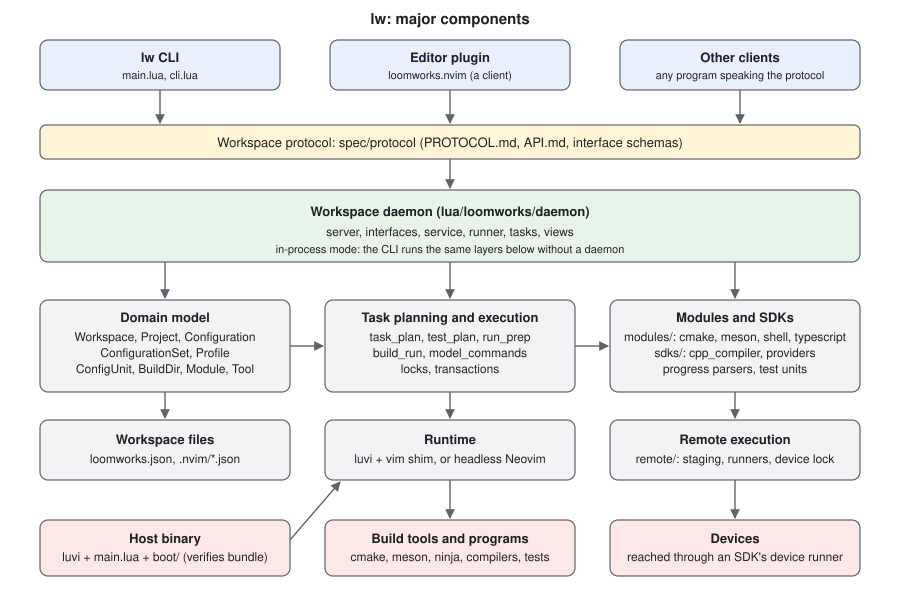
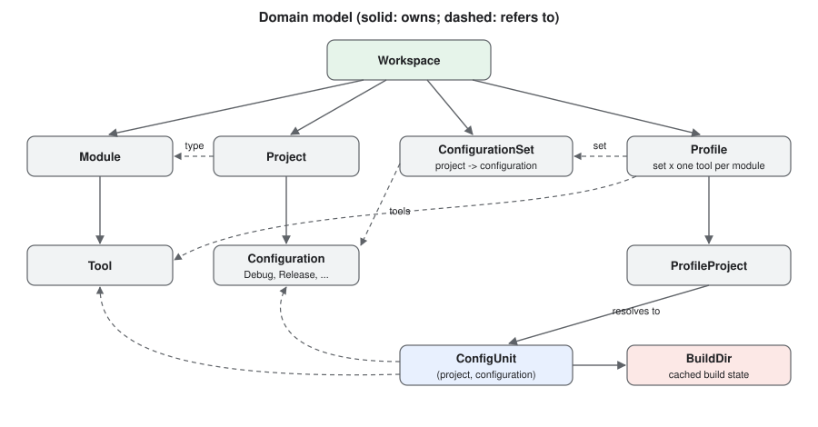
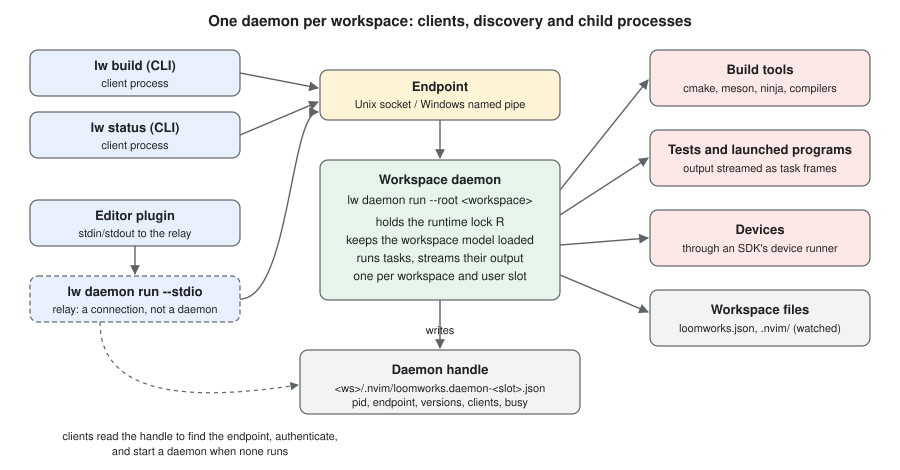

# Architecture

This document is a map of the code for a new contributor: what `lw` is, how
its parts fit together, where each part lives, and the rules a change must not
break. The wire protocol is specified separately in
[`spec/protocol/`](spec/protocol/) and the on-disk files in
[`spec/formats.md`](spec/formats.md); this document links to them instead of
repeating them.

## What lw is

`lw` drives the builds of a workspace: a directory with a `loomworks.json`
that lists one or more projects (cmake, meson, shell commands, typescript).
Each project has **configurations** (Debug, Release, ...). A **configuration
set** picks one configuration per project, and a **profile** combines a
configuration set with a toolchain (**tool**) per build system. A profile is
the unit a user builds, runs, tests and cleans:

```sh
lw build Debug:ninja-gcc-14
lw test  Debug:ninja-gcc-14
```

`lw` does not replace the build systems. It resolves what to run (the
configure, build, clean and test commands of each project, in the right
build directory, with the right compiler and environment), runs it, and keeps
the state of every build directory in a cache. It is read-only toward the
project's own files.

Everything runs in one of two ways:

- **In-process.** A CLI command loads the workspace, runs the operation and
  exits. This is the default for the CLI.
- **Through the workspace daemon.** One long-lived `lw daemon run` process per
  workspace keeps the model loaded, runs tasks and streams their output to
  clients over the [workspace protocol](spec/protocol/PROTOCOL.md). Editors
  (for example the Neovim plugin loomworks.nvim) and the CLI in daemon mode
  are clients.

Both ways run the same Lua code for the model, the planning and the
execution; the daemon adds a server, a task stream and views on top.



## Runtime: one Lua code base, two hosts

*Transition.* The specification now defines a release as one self-contained
executable per platform (spec §16.11–16.13): all code embedded, pinned and
upgraded releases cached as executables under `<data>/exe/<sha256>/`, no
separately fetched bundle. The implementation is part-way there: release
executables already embed the full tree and run it as the release, while the
bundle, its manifest and the bundle-provisioning paths described below still
ship for older hosts; this document changes with the code.

All of `lw` is Lua 5.1 / LuaJIT on top of libuv. It runs on one of two hosts:

- **luvi** (the release host). A release `lw` binary is a copy of
  [luvi](https://github.com/luvit/luvi) (LuaJIT, libuv and OpenSSL) with the
  whole Lua tree fused into it (the bootstrap, the system Lua, the release
  notes and the protocol documents; `scripts/release/stage_tree.sh`). A
  bootstrap-only host from before self-contained executables instead runs a
  separately downloaded, signature-verified **bundle**. The code is written against a
  subset of Neovim's `vim.*` API, and
  [`lua/loomworks/shim/`](lua/loomworks/shim/) provides that subset on luvi:
  `vim.json`, `vim.uv`, `vim.system` and the job API, `PATH` probing, table
  and string helpers, `vim.schedule` and `vim.wait` over the libuv loop. It
  has no editor surface (no buffers, windows or autocommands).
- **Headless Neovim** (the test host and a development fallback). `make test`
  runs the suite under `nvim --headless` with plenary.nvim, and
  [`bin/lw`](bin/lw) runs a checkout under luvi when it is on `PATH`, else
  under headless Neovim.

Code that must behave differently on the two hosts checks
`vim._loomworks_shim` (set by the shim) rather than probing for editor
features.

## Layers

### 1. Host bootstrap: `lua/main.lua` and `lua/boot/`

`main.lua` is the entry point fused into the executable. It:

1. installs its own module searchers ahead of `package.path`, so that a file
   in the current directory or next to the executable can never shadow a
   loomworks module;
2. handles the **host commands**: `version`, `install`, `self-update`,
   `bootstrap`, `release query`, and their help
   ([`boot/help.lua`](lua/boot/help.lua));
3. resolves the **source** of the rest of the code, in this order:
   `LOOMWORKS_LUA` > `--dev[=PATH]` > the `default-source=dev` setting (the
   development facility, only on that opt-in) > the code embedded in the
   executable (a release executable or a development build: it runs, and
   never an installed bundle) > for a bootstrap-only host (transitional) the
   newest verified release bundle (`<data>/lua-<version>/`). In
   pinned context, embedded code runs only when its release version is the
   pinned one and refuses otherwise;
4. honours a repository's **version pin** (`lw.pin`): workspace commands are
   redirected to the pinned release executable, acquired on demand into the
   content-addressed executable cache `<data>/exe/<sha256>/` and verified
   against the pin before every run (`boot/exe_cache.lua`). The redirect
   never provisions a bundle: a pinned release from before self-contained
   executables provisions its own. A pin before 0.1.32, whose release loads
   its bundle from the repository, is refused up front (`pin.reads_repo_bundle`);
5. runs `loomworks/cli.lua` from the resolved source.

The modules under `lua/boot/` always load from the executable itself, never
from a development source, because they verify releases:

| Module | Role |
|---|---|
| `verify.lua` | ECDSA P-256 signature check of a release's `SHA256SUMS`, SHA-256 of artifacts; carries the release public key |
| `update.lua` | fetch and verify a release executable (into the executable cache, or for self-update); update channels (stable, unstable) |
| `host_update.lua` | replace the installed executable during `lw self-update` |
| `exe_cache.lua` | the content-addressed cache of release executables a redirect runs (`<data>/exe/<sha256>/`) |
| `install.lua` | `lw install`: place the executable on `PATH` |
| `pin.lua`, `bootstrap.lua`, `launcher.lua`, `launcher_check.lua`, `repo_meta.lua` | the repo-local launcher (`lw.sh`, `lw.cmd`) and `lw.pin`: authoring, checks and repository metadata |
| `release_query.lua` | `lw release query`: the newest verified release on a channel |
| `modules.lua` | installing third-party build-system modules from a curated index |
| `download.lua`, `json.lua`, `paths.lua`, `exe.lua`, `luapath.lua` | small dependency-free helpers: curl downloads, JSON, per-user paths, program lookup, search-path hygiene |

The release trust chain: the public key embedded in the executable verifies
`SHA256SUMS.sig` over `SHA256SUMS`; `SHA256SUMS` lists the SHA-256 of every
release asset and names the release's descriptor, which binds it to that
version; each download is checked against it, or against a pin's hash. The
transport (TLS, or a mirror directory given by `LOOMWORKS_RELEASE_URL`) never
decides integrity.

### 2. CLI: `lua/loomworks/cli.lua`

`cli.lua` parses arguments, dispatches commands (`status`, `build`, `run`,
`test`, `clean`, `reset`, `profile ...`, `project ...`, `configset ...`,
`daemon ...`, `health`, `settings`, ...) and prints. Supporting files:

- `cli_options.lua`: the options every command accepts, so an unknown option
  is a usage error;
- `cli_color.lua`, `term.lua`: colouring and terminal-safe rendering. Every
  printed line is neutralised against control sequences, because names and
  paths come from workspace files;
- `config.lua`: lw's own per-user settings (`lw settings`).

The CLI decides whether to run **in-process** or through the **daemon**
([`daemon/runtime.lua`](lua/loomworks/daemon/runtime.lua)): the
`runtime-mode` setting or `LOOMWORKS_RUNTIME` selects `in-process` (the CLI's
default) or `daemon`; `--no-daemon`, `LOOMWORKS_NO_DAEMON=1` and CI
environments never start a daemon. In daemon mode the CLI connects (starting
the daemon if needed), sends the operation as an interface call and prints the
task stream exactly as the in-process path prints it.

Non-interactive use (`--no-input`, `LW_NO_INPUT`, or a CI environment) never
prompts and never guesses: a command that needs a profile must be given one.

### 3. Core and the domain model

[`app.lua`](lua/loomworks/app.lua) creates one `Core` per process.
[`core.lua`](lua/loomworks/core.lua) is the infrastructure: file I/O, the
module registry, events, the file tracker and deletion primitives. It creates
and owns the `Workspace`. `Core.new(deps)` takes injectable dependencies, which
the tests use.

[`workspace.lua`](lua/loomworks/workspace.lua) is the domain container. It owns
every registry and the logic that spans objects: loading and merging the
files, saving, publishing, the cache, operations, deletion and tool scanning.
Domain objects are Lua classes, one per file. They hold a back-reference to
their workspace and refer to each other by object, not by key:

| Object | File | What it is |
|---|---|---|
| `Workspace` | `workspace.lua` | the container; one per workspace root |
| `Module` | `module.lua` | a build-system implementation (cmake, meson, ...) as a domain object; owns its tools |
| `Tool` | `tool.lua` | a toolchain of one module (`ninja-gcc-14`, `msvc-17-2022`); modules without toolchains have one default tool |
| `Project` | `project.lua` | one project of the workspace: its module, path and module settings |
| `Configuration` | `configuration.lua` | a build variant of a project; may inherit from other configurations |
| `ConfigurationSet` | `configuration_set.lua` | a named map project -> configuration |
| `Profile`, `ProfileProject` | `profile.lua` | a configuration set with one tool per module; a profile's view of one project |
| `ConfigUnit` | `config_unit.lua` | the runtime state of one (project, configuration) build: state, build directory, last configure and build |
| `BuildDir` | `build_dir.lua` | one cache entry's build state; may exist without a unit (an orphan) |
| `LaunchConfiguration`, `LaunchTarget` | `launch_configuration.lua`, `launch_target.lua` | named programs to run, and the selected target of a profile |
| `Device` | `device.lua` | a deployment target found by a module or SDK (runtime only) |
| `SDK` | `sdk.lua` | a resolved SDK installation offered by an SDK provider |



Objects keep their identity across reloads. When a file changes,
[`data_model.lua`](lua/loomworks/data_model.lua) rebuilds the registries from
the raw file data and the existing objects: each object is updated in place
by its `_apply(data, ctx)` method, which resolves keys to references through
the deserialisation context. An object that no longer exists is flagged
`_removed`. Mutations (adding a project, selecting a profile) change the
objects directly and then save; they never round-trip through the files.

A `ConfigUnit` is identified by `(project, configuration)`, not by its build
directory path. Profiles that select the same configuration with the same
tool share one unit. Build-directory-level state (references, locks,
deletion) is keyed by the directory's resolved identity
(`Workspace:_build_dir_identity`: real path, normalised, case-folded on
Windows), so two spellings of one folder are one directory.

Other model-level files worth knowing:

- `merge.lua`: profile keys and the merge of the shared and local files;
- `variables.lua`, `expand.lua`: user variables and `${...}` expansion;
- `deploy.lua`: copy steps of launch configurations;
- `description.lua`: free-text descriptions of items;
- `model_commands.lua`: one host-neutral function per user action that
  changes the model, answering `ok` or `refused`. The CLI and the daemon's
  interface handlers both call these.

### 4. Modules and SDKs

A **module** is a stateless table of functions for one build system, in
[`lua/loomworks/modules/`](lua/loomworks/modules/): `cmake`, `meson`,
`shell` and `typescript`. The core never branches on a module's name; it calls
the module interface:

- detection and validation: `detect`, `validate`, `info`,
  `default_configurations`;
- toolchains: `detect_tools` / `detect_tools_async`, `tool_key`, `tool_label`,
  `tools_match`;
- planning: `resolve_build_dir`, `tasks`, `clean_tasks`, `map_variant`;
- optional capabilities: targets, tests (`create_test_unit`), devices,
  progress parsers, language-server configurations (`lsp_configs`),
  editable fields.

The interface is versioned
([`api_versions.lua`](lua/loomworks/api_versions.lua)): a module of another
version is refused with a message, and a project whose module is missing or
refused is kept unchanged in the files.
[`plugin_loader.lua`](lua/loomworks/plugin_loader.lua) loads module, SDK and
progress-parser files by id only from known locations, never through
`package.path`, because the ids come from workspace files.

**SDK providers** ([`lua/loomworks/sdks/`](lua/loomworks/sdks/)) find SDK
installations. `cpp_compiler` ships here; platform SDKs ship as separately
installed modules. Modules query an SDK for capabilities; the core relays
between them without knowing either. Compiler discovery and probing live in
`cpp_compilers.lua`, `msvc.lua`, `cmake_kits.lua` and `compiler_cache.lua`.

Related helpers: `progress/` (output parsers such as ninja's, for progress
reporting), `test_units/` (ctest, meson test, saved test targets) with
`gtest.lua`, and `integrations/inventory/` (detection of language servers and
debug adapters for `lw health`).

### 5. Planning and execution

Planning is separate from running:

- [`task_plan.lua`](lua/loomworks/task_plan.lua) turns a profile or unit
  operation (configure, build, clean, test build) into ready-to-spawn steps
  `{ cmd, cwd, env }`. Programs are resolved to absolute paths from absolute
  `PATH` entries only, never from the current directory.
- [`test_plan.lua`](lua/loomworks/test_plan.lua) plans and runs `lw test`:
  which units, the build they need, the ordered test steps, JUnit output.
- [`run_prep.lua`](lua/loomworks/run_prep.lua) prepares `lw run` and debug
  launches: target selection (after the pending configures, before the
  build), what the build of that target covers (`build_picks`), deploy
  steps, the resolved launch spec.
- [`build_run.lua`](lua/loomworks/build_run.lua) executes a profile build
  step by step: lock every build directory, plan, run each step, update the
  unit state. It has no terminal I/O and no process exit, so both the CLI
  and the daemon's runner drive it.
- `deletion_plan.lua` and `reset_plan.lua` plan and execute deletions and
  `lw reset`.

Shared state is protected by locks and transactions:

| Mechanism | File | Protects |
|---|---|---|
| Build-directory lock | `build_lock.lua` | one build directory across processes; exclusive for configure, clean and delete, shared for build |
| Workspace operation lock | `op_lock.lua` | operations that write several workspace files or remove build trees |
| State directory | `state_dir.lua`, `state_migration.lua` | `<root>/.lw/` and its self-ignore file; the one-time, copy-only move of a working copy from the `.nvim/` of a release before 0.2.0 (marker `.lw/migrated.json`, run by `Core:setup` before any state is read) |
| Concurrent-writer guard | `save_guard.lua` | the `.lw/` state files: a save never overwrites a change another process made since this one read the file (the cache is merged, the working copy refused) |
| Commit journal | `txn.lua` | multi-file writes: staged, then committed together, recoverable after a crash |
| Lock records | `lock_record.lua`, `lock_break.lua`, `proc.lua` | the common lock record, liveness of the holder, recovery of a dead holder's lock (`lw unlock`) |

The locks are advisory lockfiles, created atomically and kept alive by a
heartbeat. Their formats are in [`spec/formats.md`](spec/formats.md) §6.

### 6. The workspace daemon: `lua/loomworks/daemon/`

The daemon is `lw daemon run --root <workspace>`. Its main parts:

| File | Role |
|---|---|
| `server.lua` | the run loop: take the runtime lock, bind the endpoint, publish the handle, authenticate connections, dispatch frames, exit when idle |
| `endpoint.lua`, `identity.lua`, `auth.lua` | the endpoint (a Unix socket in a private per-user directory, or a Windows named pipe with an owner-only DACL), the per-user slot, the mutual HMAC handshake keyed by the machine key |
| `handle.lua`, `rlock.lua` | the handle file clients read to find the daemon, and the runtime lock that decides which process is the daemon |
| `interfaces.lua`, `core_interfaces.lua` | the interface registry (objects, interface versions, schema-checked arguments and results) and the handlers of the core interfaces (`Workspace/1`, `Build/1`, `Tests/1`, `Launch/1`, `Tasks/1`, ...) |
| `service.lua` | the live workspace: loaded on first use, kept loaded, refreshed from external file changes before each operation |
| `runner.lua` | runs a build, a test run or a run/debug preparation as a task, through the same `build_run`, `test_plan` and `run_prep` code as the CLI |
| `tasks.lua` | the task stream: start, line, output, step and end frames; ownership, observers, flow control and cancellation |
| `views.lua` | the editor views (`view.Header/1`, `view.ProjectsIndex/1`, `view.Tests/1`, `view.Workspace/1`), built by `view_state.lua` and sent whole on every change |
| `devices.lua`, `maintenance.lua`, `test_*.lua`, `snapshot.lua` | devices, deletions, test discovery and runs, read-only snapshots |
| `client.lua`, `connect.lua`, `ensure.lua`, `launch.lua`, `calls.lua` | the client side used by the CLI: connect or start, version handshake, detached launch, requests as interface calls |
| `relay.lua`, `stdio.lua`, `loopback.lua` | `lw daemon run --stdio` (a relay from standard I/O to the shared daemon, used by editors), a private stdio daemon for tests, and an in-memory transport that runs the daemon's code inside the client process |
| `discover.lua`, `command.lua` | `lw daemon list`, `status`, `stop`, `restart`, ...; daemons are found by a process scan |

The shapes the daemon speaks are defined by the protocol documents, not by
the code. [`lua/loomworks/proto/`](lua/loomworks/proto/) holds the framing,
envelope, schema validation and conformance replay, and reads the JSON
schemas from `spec/protocol/` in a checkout, or from the copy embedded in a
release executable. A handler set that does not match its interface document is
refused when it is mounted, and every argument and result is validated
against the schema.

### 7. Remote execution: `lua/loomworks/remote/`

Executables built for another platform (a phone, an embedded board) run on a
**device** through a **device runner** that an SDK provider supplies. The core
never knows a runner by name; it validates the runner's shape and uses its
command builders.

- `runners.lua`: the registry of runners and their shape;
- `transport.lua`, `spec_exec.lua`: typed operations (push, pull, exec) over
  the runner's commands, with hard timeouts;
- `manifest.lua`, `staging.lua`, `tar.lua`: what a program needs on the
  device, and a digest-based incremental sync to a per-workspace staging tree;
- `run.lua`, `test_run.lua`: a run under the device lock, with live output,
  the exit status recovered from a sentinel, and crash reports and result
  files pulled into `<build dir>/.device-runs/`;
- `device_lock.lua`, `devices.lua`, `probe.lua`, `foreign.lua`: the
  per-device lock, discovery, and detection of artifacts the host cannot run.

## Process model



- **One daemon per workspace and slot.** A slot is the operating-system user
  and, on Windows, whether the process is elevated. The runtime lock
  `<root>/.lw/daemon-<slot>.lock` decides which process is the
  daemon; a second `lw daemon run` for the same slot exits, and its client
  uses the first.
- **Discovery.** After binding its endpoint the daemon writes the handle
  `<root>/.lw/daemon-<slot>.json` (pid, endpoint, versions, busy
  state). A client reads the handle, checks the endpoint and authenticates:
  the daemon proves knowledge of a key derived from the per-user machine key
  before the client sends anything else. When no daemon runs, the client
  starts one detached (no inherited handles, working directory outside the
  workspace) and waits for it.
- **Versions.** A client whose `lw` version or schemas differ from the
  daemon's replaces an idle daemon, or asks a busy one to retire once idle.
- **Clients.** CLI processes connect directly. An editor runs
  `lw daemon run --root <ws> --stdio` and talks to that relay over standard
  I/O; the relay runs the socket handshake on its behalf.
- **Lifetime.** The daemon exits after an idle timeout
  (`daemon-idle-timeout`), when its workspace root is removed, or on request.
  `lw daemon list`, `status`, `stop` and `restart` manage it.
- **Child processes.** Build tools, tests and launched programs are children
  of whichever process runs the task: the daemon, or the CLI in-process.
  Their output reaches clients as task frames.

## Data files

A workspace has three files (their syntax: [`spec/formats.md`](spec/formats.md)):

| File | Shared? | Role |
|---|---|---|
| `loomworks.json` | committed | the published configuration: projects, configurations, configuration sets, shared profiles, launch configurations |
| `.lw/user.json` | machine-local | the **working copy**: everything the user works with, including local-only items, the active profile and selections. It is the runtime source of truth |
| `.lw/cache.json` | machine-local | build state of every build directory, detected tools, deploy records |

Changes go to the working copy; `lw publish` regenerates `loomworks.json`
from the items the user chose to share. Each item has an **intent**: `local`
(working copy only), `shared` (only in `loomworks.json`), or `local+shared`.
[`user.lua`](lua/loomworks/user.lua) and [`cache.lua`](lua/loomworks/cache.lua)
hold the schema versions and migrations of the two machine-local files.

**Trust.** A workspace may come from anywhere, so the machine-local files that
feed execution are signed with a per-user machine key
([`trust.lua`](lua/loomworks/trust.lua)). A file with a missing or foreign
signature is not used for execution until the user accepts it (`lw trust`).

Other files under `.lw/`: the lock files, the commit journal
(`.lw/txn.json`), the daemon handle, `.lw/build/` (default build
trees), `.lw/cache/`, `.lw/tmp/`, the self-ignore `.lw/.gitignore` and the
migration marker; the full layout and the migration from the `.nvim/` of
releases before 0.2.0 are [headless §16.44](spec/core/headless.md#1644-workspace-state-directory-lw). Outside the workspace, the per-user
data directory holds the machine key, the cached release executables
(`<data>/exe/<sha256>/`), acquired modules, device locks and daemon logs, and
possibly code directories left by releases before self-contained executables.
[`housekeeping.lua`](lua/loomworks/housekeeping.lua) removes leftovers of
interrupted processes there (at most daily, and on `lw cleanup`).

## Deletion safety

`lw` deletes build trees, caches and per-user leftovers. Every deletion path
checks what it removes, and a change to one of these paths needs a review
against the rules below.

- **Build directories** (`Workspace:_validate_build_dir` and
  `Workspace:_run_deletion` in [`workspace.lua`](lua/loomworks/workspace.lua),
  `Core:_validate_build_dir` in [`core.lua`](lua/loomworks/core.lua)). A build
  directory must lie under the workspace root. Prefix comparisons always
  include the separator (`path == prefix or path:sub(1, #prefix + 1) ==
  prefix .. "/"`), so `/root` never matches `/roots/x`. Paths from the cache
  are untrusted and validated before use, and a nil or empty path is never
  passed on. A directory still referenced by another cache entry
  (`_build_dir_refs`, keyed by resolved identity) is not removed.
- **Crash safety.** The cache marks an entry `unknown` before an asynchronous
  deletion starts, and drops it only after the deletion succeeded. A unit in
  `unknown` is refused by the build gate (API §8.2) until it is cleaned or
  reset.
- **`.lw/` contents** (`Core:_safe_nvim_path`, `Core:_nuke_files`). Removal
  of workspace caches and user files is confined to `<root>/.lw/`.
- **Owned language-server databases** (`Workspace:_remove_owned_lsp_dbs`,
  [`lsp_db_cleanup.lua`](lua/loomworks/lsp_db_cleanup.lua)). A database
  mirror is removed only after its build directory's deletion is confirmed,
  only when no other build directory maps to it, and only after a bounded,
  link-free path check.
- **Device paths** (`device_path_under` in
  [`remote/manifest.lua`](lua/loomworks/remote/manifest.lua),
  `remote/staging.lua`, `prune_runs` in `remote/run.lua`). A device is asked
  to remove only paths under the workspace's own staging tree; run folders
  are pruned only by their timestamp names.
- **Per-user state** ([`housekeeping.lua`](lua/loomworks/housekeeping.lua),
  `_rm_tree`). Only direct children of fixed directories whose whole name
  matches an exact pattern, past an age threshold, and never in use.
- **Launcher caches** (`prune_cache` in
  [`boot/repo_meta.lua`](lua/boot/repo_meta.lua)). Only entries with
  exact names (a release version) that pass a layout check, never the
  running executable or a pinned one.

Directories are checked with `lstat`: links and junctions are unlinked, never
followed. Where a tree is removed, its `realpath` is checked against the
expected parent. The specs `build_dir_safety_spec.lua`,
`deletion_hardening_spec.lua`, `planted_links_spec.lua`,
`housekeeping_spec.lua` and `lsp_db_cleanup_spec.lua` pin these rules.

## Repository layout

| Path | Contents |
|---|---|
| `lua/main.lua`, `lua/boot/` | the executable's entry point and release machinery (verification, acquisition, pins, launchers) |
| `lua/loomworks/cli*.lua` | the CLI |
| `lua/loomworks/*.lua` | core, workspace, domain objects, planning, locks, trust, housekeeping |
| `lua/loomworks/daemon/` | the workspace daemon and its client side |
| `lua/loomworks/proto/` | protocol framing, envelope, schemas, conformance |
| `lua/loomworks/modules/`, `sdks/` | build-system modules and SDK providers |
| `lua/loomworks/remote/` | remote execution on devices |
| `lua/loomworks/progress/`, `test_units/`, `integrations/inventory/` | progress parsers, test units, tool inventory |
| `lua/loomworks/shim/` | the `vim.*` shim for the luvi host |
| `spec/protocol/` | the wire protocol ([`PROTOCOL.md`](spec/protocol/PROTOCOL.md)), the interface suite ([`API.md`](spec/protocol/API.md)), JSON schemas, frozen versions, golden transcripts |
| `spec/core/`, `spec/modules/`, `spec/sdks/` | the behavioural specification ([`spec/core/README.md`](spec/core/README.md)), per-module and per-SDK-provider specs |
| `spec/formats.md` | the on-disk file formats |
| `docs/diagrams/` | the diagrams of this document |
| `bin/` | development launchers (`bin/lw`, `bin/lw.cmd`) |
| `keys/` | the release public key |
| `scripts/release/` | release build: the staged tree (`stage_tree.sh`), fused executables and their smoke test, signed `SHA256SUMS`, descriptor, release-notes gate (and the transitional bundle for older hosts) |
| `scripts/ci/`, `scripts/conformance.lua` | end-to-end CI scripts, protocol conformance replay |
| `scripts/run_specs.lua`, `scripts/dev-install.sh` | the test runner; a local install from the working tree |
| `tests/` | spec files (`*_spec.lua`), fixtures, the standalone suite (`tests/standalone/`) |
| `modules.json` | the index of acquirable third-party modules |

## Development

**Running from a checkout.** Put `bin/` on `PATH` (it uses luvi when
available, else headless Neovim), or point an installed `lw` at the checkout
with `lw settings set dev-lua <checkout>/lua` and run `lw --dev <command>`.
`make install` fuses a self-contained executable from the working tree and installs it.

**Tests.**

| Command | What it runs |
|---|---|
| `make test` | every `tests/*_spec.lua` under headless Neovim with plenary.nvim, one process per file, in parallel; a table names each failing file |
| `make test-file FILE=tests/config_spec.lua` | one spec file |
| `make test-standalone` | `tests/standalone/` under luvi: the bootstrap and the OpenSSL-backed verification |
| `make test-all` | both |

`make test` needs plenary.nvim (in lazy.nvim's data directory or on the
packpath); `make test-standalone` needs `luvi` on `PATH`. CI also runs
end-to-end scripts (`scripts/ci/`) against a freshly fused binary on Linux,
macOS and Windows.

**Protocol changes.** An interface change edits its JSON document under
`spec/protocol/interfaces/` and its meaning in `API.md`. Versions that a
release shipped are frozen under `spec/protocol/frozen/`;
`protocol_schema_spec.lua` checks that they only grow additively, and
`protocol_conformance_spec.lua` replays the golden transcripts against the
daemon.

**Changelog.** User-visible changes go under `## Unreleased` in
[`CHANGELOG.md`](CHANGELOG.md). The grammar is in the comment at its top and
is checked by `tests/release_notes_spec.lua` and by the release gate.
`lw release-notes` shows these notes from the installed release.

## Releases

A release consists of:

- one **release executable** per platform (`lw-linux-x86_64`,
  `lw-linux-arm64`, `lw-macos-arm64`, `lw-macos-x86_64`,
  `lw-windows-x86_64.exe`; the list and each one's first release are
  `boot.pin.HOST_ASSETS` / `HOST_ASSET_SINCE`): luvi with all of `lua/`,
  the protocol schemas and the release notes fused in, and the release
  public key embedded in `boot/verify.lua`;
- `SHA256SUMS` with the SHA-256 of every asset, and its ECDSA P-256
  signature `SHA256SUMS.sig`: what self-update, pinned forwarding and
  `lw bootstrap` verify against;
- a binary descriptor (`lw-<version>-descriptor.json`) that states what the
  release implements;
- while the transition lasts (spec §16.14), the bundle
  `loomworks-lua-<version>.zip` and its signed `manifest.json`, used only by
  hosts released before self-contained executables.

Releases are cut in two stages ([`release.yml`](.github/workflows/release.yml)):
a dispatched build stage stages every asset as an unpublished draft from a
build commit; an annotated tag `v<version>` on that commit publishes the
draft once [`verify_draft.sh`](scripts/release/verify_draft.sh) accepts it.

The private signing key exists only as a CI secret. The public key is
[`keys/loomworks-release.pub.pem`](keys/loomworks-release.pub.pem);
`tests/standalone` checks that the key embedded in `boot/verify.lua` and the
copies in the README are that key. `lw self-update` installs a newer release
executable only after the signature and hash verify, and a repository's
`lw.pin` fixes the version and hashes it runs. `make dist` builds a local
dry run signed with a test key.
